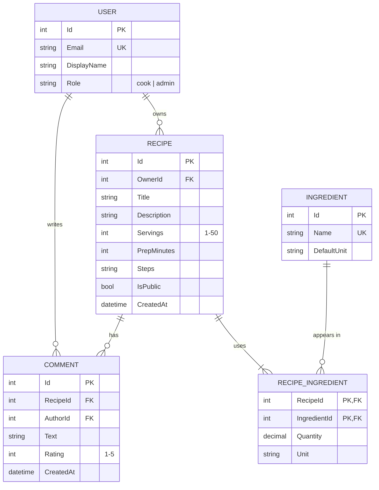

# Data Model — Recipe Box

## Where the foreign keys are, and why

- **User 1:N Recipe** — `Recipe.OwnerId` references `User`. The FK is on the "many" side: each
  recipe has exactly one owner, a user can own many recipes.
- **User 1:N Comment** — `Comment.AuthorId` references `User`, for the same reason.
- **Recipe 1:N Comment** — `Comment.RecipeId` references `Recipe`.
- **Recipe M:N Ingredient** — neither table can hold the FK (a recipe has many ingredients *and* an
  ingredient is in many recipes), so the join entity `RecipeIngredient` holds both FKs. Its primary
  key is the pair (`RecipeId`, `IngredientId`), so an ingredient appears at most once per recipe.
  It is a full entity, not just a join table, because the relationship has its own data:
  `Quantity` and `Unit`.

## Constraints

| Rule | Where it is enforced |
|------|----------------------|
| `Servings` between 1 and 50 | DB check constraint (week 2), API validation (week 4) |
| Ingredient names unique | Unique index on `Ingredient.Name` |
| One comment per user per recipe | Unique index on (`RecipeId`, `AuthorId`) (week 5, when comments are added) |
| A recipe has at least 1 ingredient | Service/API validation (week 4); can't be a simple DB constraint |

## Implemented so far

Week 2: `Recipe`, `Ingredient`, `RecipeIngredient`. `User` and `Comment` follow in week 5
(authentication).
